# 🎨 Awesome-Generative-AI-UI-Diffusion-Workflows

  

  
  
  
  
  

---

## 🧩 Curated Generative AI UI, Local Interfaces & Diffusion Workflows

> 🌟 **A definitive, production-grade guide to Generative AI UI architectures, node-graph diffusion studios, local web interfaces, real-time creative canvases, and serverless workflow deployment.**

Whether you are designing reproducible multi-modal pipelines in **ComfyUI**, running low-VRAM inference locally with **Forge** or **Fooocus**, collaborating in infinite real-time canvas studios like **InvokeAI** and **Krita**, or deploying headless diffusion models at scale via **fal.ai**, this catalog benchmarks the leading commercial SaaS platforms and top open-source projects.

### 🔍 Quick Navigation
- [📊 Sector Overview & Market Dynamics](#-sector-overview--market-dynamics)
- [☁️ SaaS & Commercial Platforms](#️-saas--commercial-platforms)
- [💻 Open-Source GitHub Projects](#-open-source-github-projects)
- [📈 Star History](#-star-history)
- [🛠️ How to Contribute](#️-how-to-contribute)
- [💖 Support & Community](#-support--community)
- [⚠️ Disclaimer](#️-disclaimer)

---

## 📊 Sector Overview & Market Dynamics

The global Generative AI Creative UI, Node-Based Diffusion Workflow, and GPU Inference market is estimated at **$8.4B–$11.5B+ in 2026**, expanding at a ~28%–36% CAGR fueled by node-graph workflow portability (`ComfyUI` JSON), real-time latent canvas interaction (`Krea`, `InvokeAI`), and serverless GPU media APIs (`fal.ai`, `ComfyDeploy`).

The commercial SaaS layer displays **strong market concentration** around creative software giants (e.g., Canva/Leonardo AI) and proprietary foundation-model labs (Midjourney), whereas the **workflow authoring, custom node ecosystem, and local execution layers are intensely community-driven and open-source led** (`AUTOMATIC1111`, `ComfyUI`, `InvokeAI`, `Fooocus`, `SwarmUI`).

---

## ☁️ SaaS & Commercial Platforms

*Sorted descending by company valuation / annual revenue scale.*

| 🏢 Platform | 📝 Description | 💼 Scale (Valuation / Revenue) | 💳 Starting Paid Tier | 🎁 Free Tier / Trial Limits |
| :--- | :--- | :--- | :--- | :--- |
| **[Leonardo AI (Canva)](https://leonardo.ai)** | Creative suite with real-time canvas, Flow State, and custom model fine-tuning for games, marketing, and concept art. | **Acquired by Canva for ~$370M+** (Canva valued at $26B+; ~$2.5B+ ARR) | **$10 / month** billed annually ($12/mo monthly for Apprentice tier; 8,500 fast tokens/mo) | **Forever Free Plan**: **150 fast tokens daily** (resets every 24 hours, public queue & standard generation) |
| **[Midjourney](https://midjourney.com)** | Premier artistic generative AI image synthesis platform with unified web canvas, style references (`--sref`), and character consistency. | **~$300M+ Annual Revenue** (Bootstrapped, highly profitable independent AI research lab) | **$10 / month** ($8/mo billed annually for Basic plan; ~200 fast GPU min/mo) | **No Perpetual Free Tier**: Free generations discontinued; occasional promotional weekend trials (requires $10/mo Basic for recurring use) |
| **[fal.ai](https://fal.ai)** | Sub-second serverless GPU media inference platform with managed endpoints for FLUX, Stable Diffusion, video models, and ComfyUI workflows. | **~$150M–$300M+ Valuation** ($49M+ venture capital led by a16z & Kindred) | **Pay-per-second GPU Compute**: Starting from **~$0.0003–$0.0011/sec** (~$0.01–$0.05 per generated image) | **Free Starter API Credits**: Complimentary initial credit balance granted upon registration to test serverless inference endpoints |
| **[Krea AI](https://krea.ai)** | Live generative AI canvas, webcam/screen-to-image real-time generation, 4K enhancer, and generative video tools. | **~$100M–$200M Est. Valuation** ($35M+ VC funding led by Bain Capital Ventures & a16z) | **$8 / month** billed annually ($10/mo monthly for Basic tier; 3,600 compute units/mo) | **Forever Free Basic Plan**: Limited daily real-time canvas generations and standard-speed upscale credits |
| **[SeaArt](https://seaart.ai)** | Web-based AI art creation engine, LoRA/checkpoint hub, and browser-accessible ComfyUI cloud workflow runner. | **~$30M–$60M Est. Valuation** (>15M registered global creators) | **$2.99 / month** ($9.99/mo Standard tier for accelerated GPU priority and private cloud workflows) | **Forever Free Daily Stamina**: **130–150 free stamina credits daily** (resets every 24 hours for model generations and workflow runs) |
| **[ComfyUI Cloud (Comfy Org)](https://comfy.org)** | Official Comfy Org cloud ecosystem, desktop application release, and serverless workflow deployment services (ComfyDeploy / RunComfy). | **~$20M–$40M Est. Valuation** (Venture-backed creator organization behind ComfyUI) | **Pay-as-you-go GPU Time**: Starting at **~$0.01–$0.03/min** on serverless cloud runs; local desktop is $0 | **Forever Free Open-Source App**: Local ComfyUI Desktop & CLI is 100% free forever; hosted trials include free starter cloud credits |
| **[InvokeAI (Hosted Studio)](https://invoke.com)** | Commercial enterprise studio and team workspace powered by the open-source Invoke Unified Canvas and visual node workflow pipeline. | **~$15M–$30M Est. Valuation** (Venture-backed open-core creator platform) | **$19 / user / month** (Indie & Pro Studio plan; custom pricing for enterprise team governance & private models) | **Forever Free Local Edition**: Apache-2.0 self-hosted engine is 100% free forever; **14-day free trial** offered for hosted team studio |

---

## 💻 Open-Source GitHub Projects

*Sorted descending by repository star count. Badges link directly to each project's stargazers page.*

| 📦 Repository & Stars | 📜 License | 🖥️ Architecture / Interface Style | 📝 Highlights & Core Capabilities |
| :--- | :--- | :--- | :--- |
| **[AUTOMATIC1111/stable-diffusion-webui](https://github.com/AUTOMATIC1111/stable-diffusion-webui)**    | `AGPL-3.0` | Gradio WebUI | The foundational, battle-tested open-source web interface for Stable Diffusion. Massive ecosystem of 500+ extensions, ControlNet, LoRA, and inpainting tools. |
| **[comfyanonymous/ComfyUI](https://github.com/comfyanonymous/ComfyUI)**    | `GPL-3.0` | Modular Node Graph | The industry-standard modular node-based diffusion execution engine. Powers reproducible graph workflows, FLUX, SDXL, video diffusion, and headless API serving. |
| **[lllyasviel/Fooocus](https://github.com/lllyasviel/Fooocus)**    | `GPL-3.0` | Minimalist WebUI | Streamlined Midjourney-style offline image generation UI by ControlNet creator lllyasviel. Automated prompt expansion, SDXL native optimizations, and low-VRAM defaults. |
| **[huggingface/diffusers](https://github.com/huggingface/diffusers)**    | `Apache-2.0` | Python Library & Core Pipeline | The premier Python foundation library for state-of-the-art diffusion models across PyTorch, JAX, and ONNX. Underpins countless creative GUIs and production inference servers. |
| **[invoke-ai/InvokeAI](https://github.com/invoke-ai/InvokeAI)**    | `Apache-2.0` | Unified Canvas & Node Editor | Professional creative engine uniting an infinite latent canvas with a modular node-based backend. Built for game studios, concept artists, and commercial digital illustrators. |
| **[ltdrdata/ComfyUI-Manager](https://github.com/ltdrdata/ComfyUI-Manager)**    | `GPL-3.0` | ComfyUI Extension & Package Manager | Essential extension for ComfyUI enabling 1-click discovery, installation, and dependency management for hundreds of community custom node packs and models. |
| **[lllyasviel/stable-diffusion-webui-forge](https://github.com/lllyasviel/stable-diffusion-webui-forge)**    | `AGPL-3.0` | High-Performance WebUI | Drop-in WebUI alternative re-engineered with an advanced memory-management backend. Dramatically accelerates generation speed, reduces VRAM overhead, and supports FLUX.1. |
| **[Acly/krita-ai-diffusion](https://github.com/Acly/krita-ai-diffusion)**    | `GPL-3.0` | Digital Painting Plugin (Krita) | Native AI generation plugin for the open-source Krita digital painting software. Features real-time live canvas painting, inpainting, ControlNet guidance, and layer workflow integration. |
| **[vladmandic/automatic (SD.Next)](https://github.com/vladmandic/automatic)**    | `Apache-2.0` | Multi-Backend Advanced WebUI | Modernized all-in-one diffusion WebUI supporting multiple backends (Diffusers, Original SD, ONNX, DirectML), FLUX, video synthesis, and comprehensive profiling. |
| **[cubiq/ComfyUI_IPAdapter_plus](https://github.com/cubiq/ComfyUI_IPAdapter_plus)**    | `GPL-3.0` | ComfyUI Node Pack | Definitive ComfyUI implementation of IP-Adapter. Enables powerful image prompting, style transfer, face-id conditioning, and visual cross-attention workflows. |
| **[mcmonkeyprojects/SwarmUI](https://github.com/mcmonkeyprojects/SwarmUI)**    | `MIT` | Multi-GPU Orchestrator & UI | High-performance modular diffusion frontend and multi-GPU cluster coordinator (formerly StableSwarmUI). Seamlessly routes batches across multiple local or network backends. |
| **[Fannovel16/comfyui_controlnet_aux](https://github.com/Fannovel16/comfyui_controlnet_aux)**    | `Apache-2.0` | Preprocessor Node Pack | Universal collection of ControlNet and T2I preprocessors for ComfyUI, including OpenPose, Depth, LineArt, Canny, Normal Maps, and Segment Anything. |
| **[Kosinkadink/ComfyUI-AnimateDiff-Evolved](https://github.com/Kosinkadink/ComfyUI-AnimateDiff-Evolved)**    | `Apache-2.0` | Video Animation Nodes | Advanced animation nodes integrating AnimateDiff with sliding-context sampling, motion LoRAs, and camera control inside ComfyUI. |
| **[kijai/ComfyUI-KJNodes](https://github.com/kijai/ComfyUI-KJNodes)**    | `GPL-3.0` | Utility & Workflow Nodes | Essential utility node suite for ComfyUI featuring color grading, mask manipulation, batch processing, image conditioning, and canvas helper nodes. |
| **[ltdrdata/ComfyUI-Impact-Pack](https://github.com/ltdrdata/ComfyUI-Impact-Pack)**    | `GPL-3.0` | Automation & Enhancer Nodes | Advanced ComfyUI node collection for automated face/hand detailing, segmentation (SEGS), wildcards, workflow logic branches, and iterative latent upscaling. |
| **[lshqqytiger/stable-diffusion-webui-directml](https://github.com/lshqqytiger/stable-diffusion-webui-directml)**    | `AGPL-3.0` | DirectML WebUI Port | AMD and Intel GPU-compatible fork of AUTOMATIC1111 WebUI using Microsoft DirectML for acceleration on Windows machines without CUDA. |

---

## 📈 Star History

---

## 🛠️ How to Contribute

Contributions are warmly welcomed! Help keep this curated list cutting-edge and comprehensive:

1. 🍴 **Fork the repository** to your personal GitHub account.
2. 🌿 **Create a topic branch**: `git checkout -b feature/add-new-tool`
3. 📝 **Add or update entries**: Ensure entries are placed in the appropriate section, keep descriptions factual, and include exact pricing/free tier or license specifications.
4. 🚀 **Commit your changes**: `git commit -m 'Add ToolName to Generative AI UI Workflows'`
5. 📤 **Push and submit a Pull Request** with a brief summary of the project.

---

## 💖 Support & Community

Thank you so much for exploring and using this repository! If you find this resource helpful for your creative AI workflows, research, or development projects, please consider showing your support:

- ⭐ **Star this repository** to help others discover it across GitHub.
- 🍴 **Fork and share** with colleagues, AI artists, and ML pipeline builders.
- 💬 **Join our Discord** at [discord.gg/jc4xtF58Ve](https://discord.gg/jc4xtF58Ve) to discuss workflows, nodes, and generative art.
- ☕ **Buy me a coffee / Sponsor**: If you'd like to support continued maintenance and curation, you can sponsor through the **[GitHub Sponsors Dashboard](https://github.com/sponsors/ishandutta2007)**.

---

## ⚠️ Disclaimer

*All product names, logos, trademarks, and registered trademarks belong to their respective owners. Mention of commercial platforms and open-source projects is strictly for informational and benchmarking purposes and does not imply official endorsement.*
